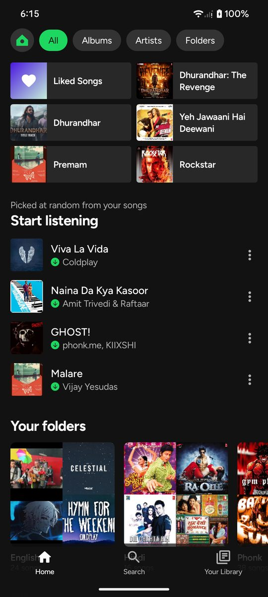
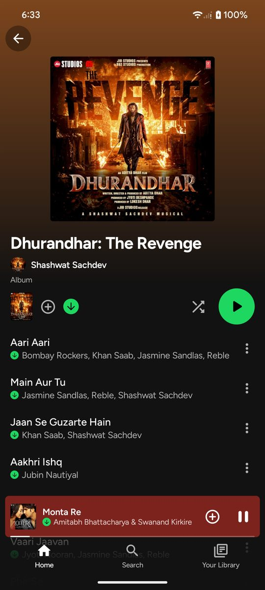
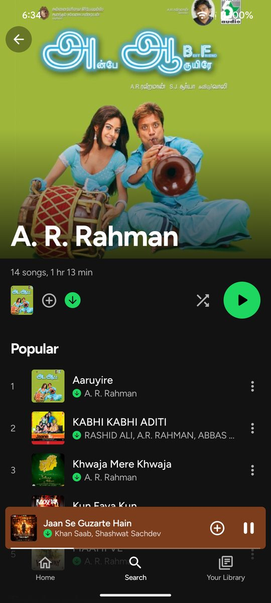
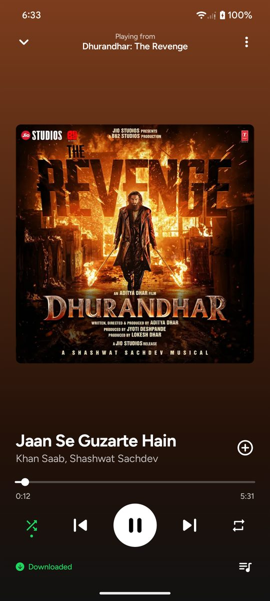
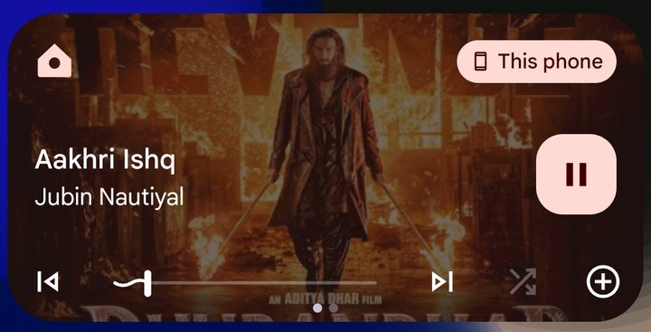
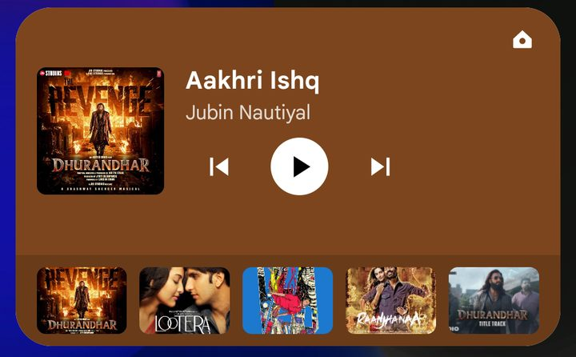
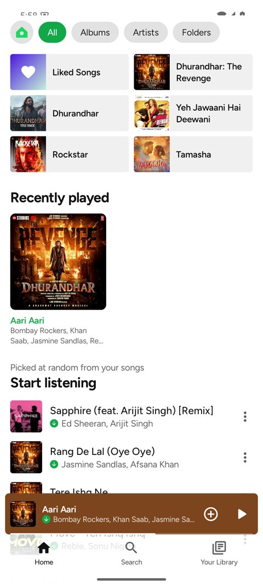
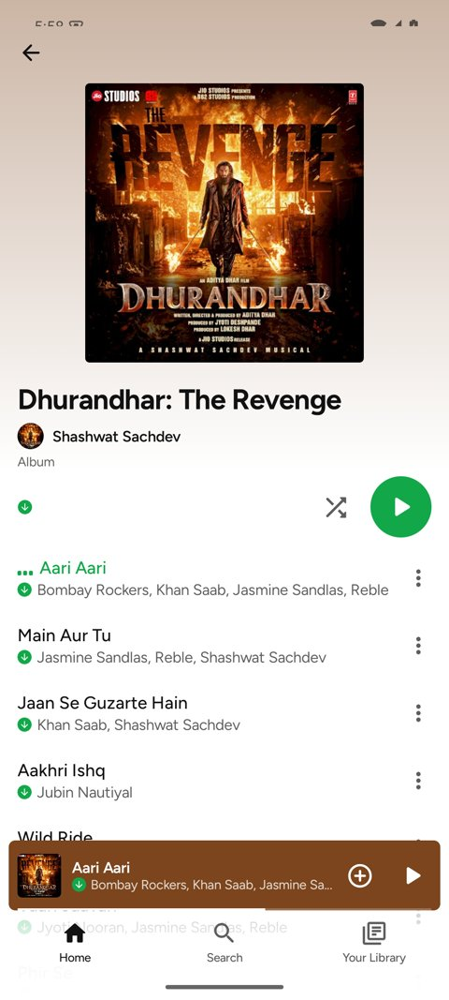

<p align="center">
  
</p>

<h1 align="center">Attic</h1>

<p align="center">
  <b>A Spotify-style player for the MP3s already on your phone.</b><br>
  No account, no streaming, no ads. It plays in airplane mode.
</p>

<p align="center">
  
  
  
</p>

<p align="center">
  
  
  
  
</p>

## Why it exists

Local music players tend to look like file managers. Attic gives a folder of MP3s the layout and navigation of a modern streaming app: tinted album headers, a floating mini player, a queue you can drag around, and lyrics that follow the song. Everything plays from your own storage.

It was built for one phone and one library of 279 songs, and every number below was measured on that phone.

## What it does

**Plays your library**
- Home, Search and Your Library tabs, with album, artist and playlist screens
- A mini player and a full Now Playing screen, tinted from the cover art
- Shuffle, repeat, and a queue with drag to reorder and swipe to remove
- Liked songs and your own playlists, stored on the device
- Dark and light themes, or match the phone

**Keeps playing outside the app**
- Background playback with notification and lock-screen controls, including shuffle and like
- Media button support for Bluetooth and headsets, and it pauses when another app takes audio focus
- A resizable home-screen widget with the current song, controls and five recent albums

<p align="center">
  
  
</p>

**Shows lyrics, then keeps them**
- Synced lyrics highlight the current line, and tapping a line jumps to it
- Download one song or the whole library from [LRCLIB](https://lrclib.net), then use them offline

**Cleans up messy tags**

61 of the 279 songs it was built around are YouTube downloads with no album tag and an uploader name where the artist should be, so Attic works out what the tags meant. Nothing is written back to your files.

| In the file | In Attic |
|---|---|
| `Coldplay - Hymn For The Weekend (Lyrics)` by `DopeMusic` | **Hymn For The Weekend** by Coldplay |
| `Gulabi [kTpyO8iwlSY].mp3`, no tags | **Gulabi** |
| `A.R. RAHMAN`, `A.R. Rahman`, `A. R. Rahman` | One artist page |
| `English/`, `Hindi/`, `Tamil/`, `Phonk/` folders | Playlists, not artists |
| `Various Artists/` folder | The real performers get the credit |

## Light mode

<p align="center">
  
  
</p>

## Performance

Measured on a POCO M4 Pro 4G running Android 16, scrolling the full song list.

| | Release build | Debug build |
|---|---|---|
| Janky frames | 3% | 32% |
| Cold start | 0.7 s | 1.8 s |
| APK size | 4.7 MB | 75 MB |

Install the release build for everyday use. Compose runs far slower in a debug build.

## Install

1. Download `attic-v1.0.0.apk` from [Releases](../../releases).
2. Open it on your phone and allow the install.
3. Put your MP3s in `Music/Offline` on the phone. Attic only looks in that folder.
4. Open Attic and allow audio access and notifications.

Folders work like this: `Music/Offline/Artist/Album/song.mp3` becomes an artist and an album. `English`, `Hindi`, `Tamil` and `Phonk` become playlists. Those four names and the `Music/Offline` path are hard-coded in [`LibraryBuilder.kt`](app/src/main/java/app/attic/player/data/LibraryBuilder.kt), so change them there for your own library.

## Build from source

You need JDK 17 and the Android SDK with platform 37.

```bash
git clone https://github.com/srivathsanvenkateswaran/attic.git
cd attic
./gradlew :app:testDebugUnitTest   # run the unit tests
./gradlew :app:assembleRelease     # build the APK
adb install -r app/build/outputs/apk/release/app-release.apk
```

The release build is signed with the debug key, which suits sideloading on your own phone and nothing else.

## How it's built

| Part | Choice |
|---|---|
| UI | Kotlin, Jetpack Compose, Material 3 |
| Playback | Media3 ExoPlayer with `MediaSessionService` |
| Library | MediaStore |
| Your data | Room: likes, playlists, history, the saved queue and lyrics |
| Covers | Coil, loading embedded art through MediaStore thumbnails |
| Widget | `RemoteViews`, with one layout for each size |

Worth reading if you open the code:

- **Shuffle reorders the real playlist** instead of keeping a separate play order, so the queue screen always shows what will actually play. See [`PhysicalShuffle.kt`](app/src/main/java/app/attic/player/playback/PhysicalShuffle.kt).
- **Saved data points at file paths, not MediaStore IDs**, so likes and playlists survive a media rescan.

## Privacy

Attic has no account, analytics or ads, and playback never touches the network. The one exception is lyrics: when you download them, Attic sends the song's title, artist, album and length to lrclib.net. Your music files are never uploaded.

| Permission | Used for |
|---|---|
| `READ_MEDIA_AUDIO` | Reading your music |
| `POST_NOTIFICATIONS` | Playback controls |
| `FOREGROUND_SERVICE`, `FOREGROUND_SERVICE_MEDIA_PLAYBACK`, `WAKE_LOCK` | Playing with the screen off |
| `INTERNET` | Lyrics downloads only |

## Known limits

- It reads `Music/Offline` only, and the release build has been tested on one phone.
- Artists use cover art because there are no artist photos, and "Popular" means what you played recently.
- Android draws the lock-screen player, so the app controls its content but not its layout.
- Lyrics depend on what LRCLIB has, and found them for 236 of the 279 songs tested.
- Title cleanup is a set of rules, so an unusual upload title can still come out wrong.

## Credits and legal

Attic is an independent personal project, and it is not affiliated with or endorsed by Spotify. Spotify is a trademark of Spotify AB. Attic contains no Spotify code, logos or assets.

Built with [Media3](https://developer.android.com/media/media3), [Jetpack Compose](https://developer.android.com/compose), [Room](https://developer.android.com/training/data-storage/room), [Coil](https://coil-kt.github.io/coil/) and [Reorderable](https://github.com/Calvin-LL/Reorderable). Lyrics come from [LRCLIB](https://lrclib.net). The [Figtree](https://github.com/erikdkennedy/figtree) font is bundled under the [SIL Open Font License](third_party/OFL-figtree.txt).

Cover art in the screenshots belongs to its respective owners. No license has been chosen for this code yet, so all rights are reserved.
