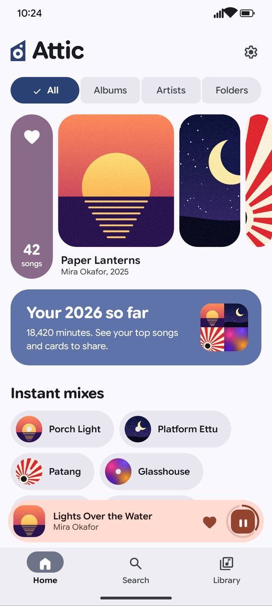
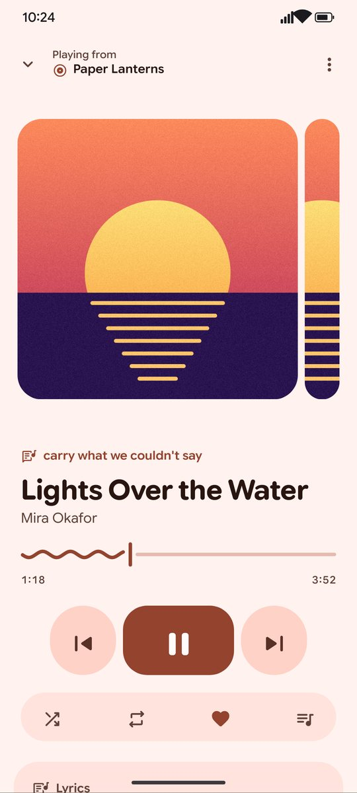
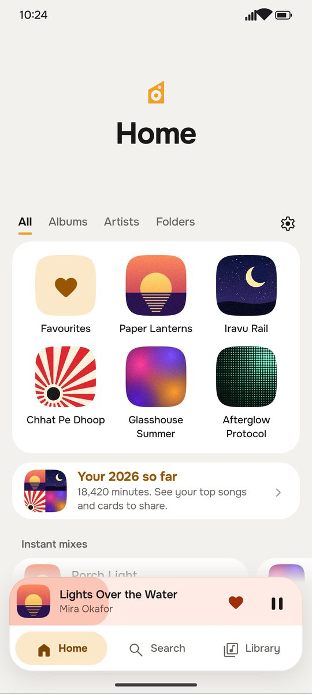
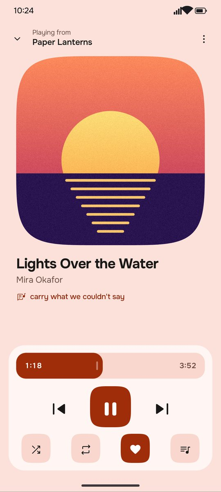
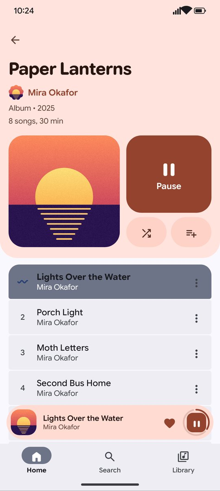
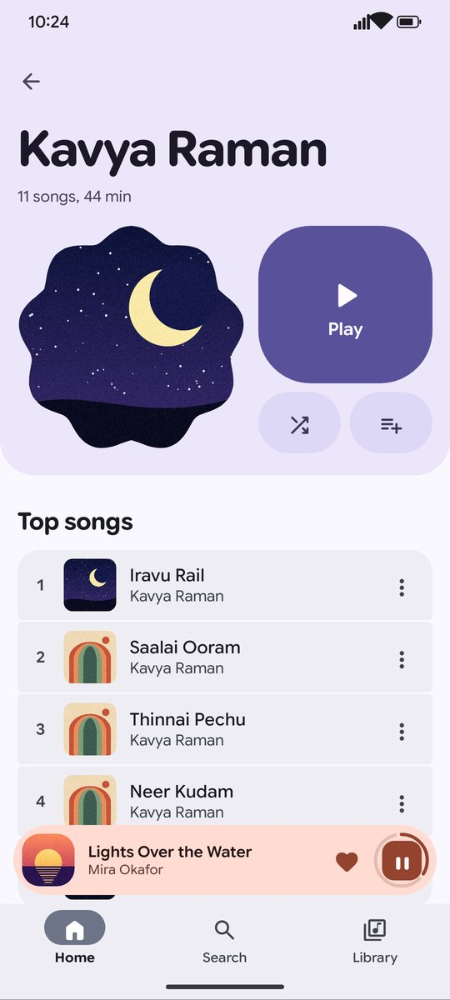
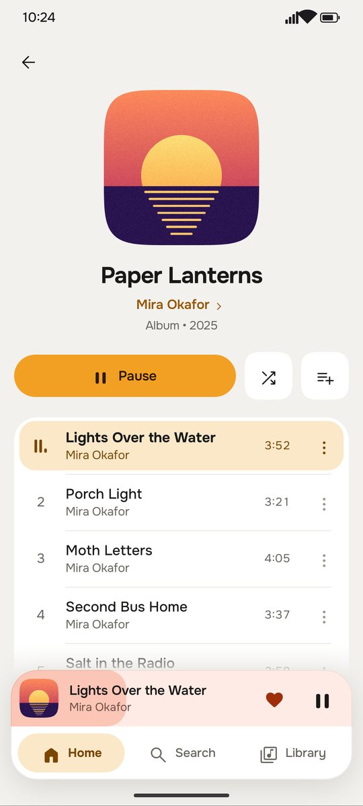
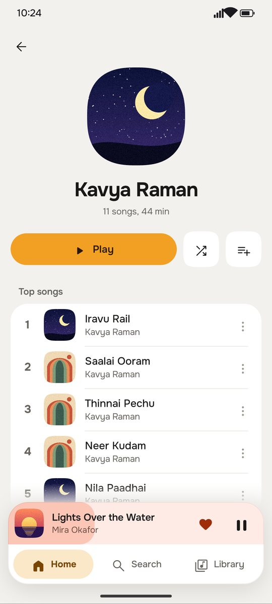

<p align="center">
  
</p>

<h1 align="center">Attic</h1>

<p align="center">
  <b>A music player for the songs already on your phone.</b><br>
  No account, no streaming, no ads. It plays in airplane mode.
</p>

<p align="center">
  
  
  
</p>

<p align="center">
  
  
  
  
</p>

## Why it exists

Local music players tend to look like file managers. Attic gives a folder of music files album and artist pages tinted from their covers, a mini player, a queue you can drag around, and lyrics that follow the song. Everything plays from your own storage.

It was built for one phone and its library of 740 songs, 279 MP3 and 461 M4A. Every number below was measured on that phone, and the counts out of 279 cover the MP3s.

## What it does

**Plays your library**
- Home, Search and Library tabs, with album, artist and playlist screens
- A mini player and a full Now Playing screen, tinted from the cover art
- Shuffle, repeat, and a queue with drag to reorder and swipe to remove
- Swipe a song row towards the end of the line to add it to the queue
- Favourites and your own playlists, stored on the device
- MP3, M4A, FLAC, Ogg, Opus and WAV files
- Dark and light themes, or match the phone
- Two styles to pick from in Settings, Expressive and Comfort. The default depends on the phone
- Light haptics on like, play and pause, reordering and swipe to queue, following the phone's touch-feedback setting

**Finds what to play next, offline**
- Start radio from any song: Attic keeps ten similar songs in the queue, where you can reorder or remove them as usual
- Instant mixes on Home: nine tiles of your favourites and unplayed songs that sound like them, changing daily
- Mixes on Home: three to five mixes of the songs you play and like, grouped by how they sound and topped up with songs you rarely play that sound like them. They are named after their artists and change once a day
- Mood mixes on Home: one mix a day for each of Chill, Happy, Energetic, Focus, Party, Melancholy and Romantic that has at least eight songs, from mood scores worked out on the phone and the moods, genres and languages you pick in Settings > Moods. A mood's page has Play, shuffle and Mood radio, and Search's Browse lists the moods too
- "On repeat", "Haven't heard in a while" and "Newly added" shelves on Home, from the listening log and the dates your files arrived
- Smart shuffle on playlists and Favourites puts one similar song from the rest of the library after every two of the collection's own
- Genres in Search, from your files' genre tags or the styles the analysis model hears, and radio from any genre
- Stays in the language you're listening to, with about one song in ten from another language when the match is strong
- Plays one version of a song, so a Tamil session gets Aaruyire and a Hindi session gets Tere Bina, not both
- Learns from skips, finishes and likes in a listening log kept on the phone

**Plays it the way you set it**
- Transitions between songs: off by default, a crossfade of 2 to 12 seconds, or Smart, which starts the next song as this one winds down, skips silence, picks an overlap of 1 to 12 seconds and lines up a beat of each when the tempos are within 6%. Songs not analysed yet get the crossfade length, and songs from one album played in order still run straight into each other
- Volume levelling, on by default: songs play at a similar loudness, from their ReplayGain tags or the loudness measured during analysis
- A ten-band equaliser of Attic's own, off by default, with eleven presets and your own. Open it from the menu on Now Playing
- A song or an album can keep its own equaliser setting, which comes back whenever it plays: a song uses its own, else its album's, else the default. A pill on Now Playing shows when one is in use
- The equaliser runs inside Attic's audio path, so it sounds the same on every phone, changes on a song's first sample, gapless songs included, and keeps each song's own curve through a crossfade. Boost presets play quieter rather than distort
- Settings > Playback > Equaliser holds the default curve, lists the songs and albums with their own setting, and opens the phone's own equaliser when it has one

**Keeps playing outside the app**
- Background playback with notification and lock-screen controls, including shuffle and like
- Media button support for Bluetooth and headsets, and it pauses when another app takes audio focus
- A resizable home-screen widget with the current song, controls and five recent albums
- Supports Android Auto: browse Home, Playlists, Albums and Artists with covers, search, and "play X on Attic" by voice ([details](docs/play/ANDROID-AUTO.md))

**Shows lyrics, then keeps them**
- Synced lyrics highlight the current line, and tapping a line jumps to it
- Reads lyrics already on the phone, with no network: a `.lrc` file with the song's name in the same folder, or lyrics in the file's tags (`SYLT` and `USLT` in MP3s, `©lyr` in M4As, `LYRICS` in FLAC and Ogg)
- Download the rest, one song or the whole library, from [LRCLIB](https://lrclib.net), then use them offline. Songs with lyrics in their files are skipped

**Cleans up messy tags**

61 of the 279 MP3s it was built around are YouTube downloads with no album tag and an uploader name where the artist should be, so Attic works out what the tags meant. Nothing is written back to your files.

| In the file | In Attic |
|---|---|
| `Coldplay - Hymn For The Weekend (Lyrics)` by `DopeMusic` | **Hymn For The Weekend** by Coldplay |
| `Gulabi [kTpyO8iwlSY].mp3`, no tags | **Gulabi** |
| `A.R. RAHMAN`, `A.R. Rahman`, `A. R. Rahman` | One artist page |
| `English/`, `Hindi/`, `Bollywood/`, `Snaptube/` folders | Playlists, not artists |
| `Various Artists/` folder | The real performers get the credit |
| One soundtrack filed under each singer's folder, album artist `Various Artists` | One album |
| Genre `Music` or `People & Blogs`, copied from YouTube | No genre |

## Two styles

Attic has two looks, Expressive and Comfort. Switch between them in Settings > Appearance; the change applies at once and the song keeps playing. Both come in light and dark.

<p align="center">
  
  
  
  
</p>

The screenshots use a demo library with invented artists and generated covers.

## Performance

Measured on a POCO M4 Pro 4G running Android 16, with release builds and a library of 740 songs. Each figure is a median over repeated runs: 20 cold starts and 6 scrolls of the full song list per style.

| | Expressive | Comfort |
|---|---|---|
| Janky frames, scrolling the song list | 2.2% | 2.5% |
| Cold start | 0.25 s | 0.24 s |
| Memory at Home (PSS) | 242 MB | 243 MB |

The release APK is 64 MB because it carries the analysis model, its runtime and the mood classifiers, and it only runs on 64-bit ARM phones.

Song analysis takes about 27 seconds per MP3 on that phone, nearly all of it decoding, and runs in the background while charging. Mixes, mood mixes, genres from analysis and measured loudness wait for it, so on a new library, or one analysed before 1.1.0, they fill in as it reaches each song. After an update to 1.3.0, analysis reads each song once more so Romantic can have a mix; the other moods work from the start.

The equaliser costs about 1.4% of one core while a curve is on, and left cold start and scrolling unchanged on the same phone ([details](docs/equaliser.md)).

Install the release build for everyday use. Compose runs far slower in a debug build.

## Install

1. Download the APK from the [latest release](../../releases/latest).
2. Open it on your phone and allow the install.
3. Copy your music onto the phone. Attic finds songs in any folder that Android indexes, including `Music`, `Download` and an SD card. It leaves out ringtones, alarms, notification sounds, recordings, podcasts, audiobooks and chat voice notes.
4. Open Attic and allow audio access and notifications.

Folders work like this: `Artist/Album/song.mp3` under the library root becomes an artist and an album. The root is the standard folder the songs sit in, such as `Music/`, or a single folder inside it that holds at least 90% of them in subfolders of its own and isn't named after their artist, so `Music/Offline/Artist/Album/song.mp3` reads the same way.

Each folder at the top of the root is an artist folder when more than half of its tagged songs credit the folder's name as artist, album artist or composer, or when none of its songs has those tags. Any other folder, such as `Bollywood/`, `Workout/` or `Snaptube/`, becomes a read-only playlist. `Various Artists/` holds compilations and credits each song's own performers. Albums group by album name and album artist, falling back to the artist folder when a song has no album artist tag. [`LibraryScope.kt`](app/src/main/java/app/attic/player/data/LibraryScope.kt) has the full rule.

## Build from source

You need JDK 17 and the Android SDK with platform 37.

```bash
git clone https://github.com/srivathsanvenkateswaran/attic.git
cd attic
./gradlew :app:testDebugUnitTest   # run the unit tests
./gradlew :app:assembleRelease     # build the APK
adb install -r app/build/outputs/apk/release/app-release.apk
```

The release build is signed with the debug key, which suits sideloading on your own phone and nothing else.

## How it's built

| Part | Choice |
|---|---|
| UI | Kotlin, Jetpack Compose, Material 3 |
| Playback | Media3 ExoPlayer with `MediaLibraryService`, which also serves the Android Auto browse tree |
| Library | MediaStore |
| Your data | Room: likes, playlists, history, the saved queue, lyrics, equaliser settings and mood scores |
| Covers | Coil, loading embedded art through MediaStore thumbnails |
| Widget | `RemoteViews`, with one layout for each size |

Worth reading if you open the code:

- **Shuffle reorders the real playlist** instead of keeping a separate play order, so the queue screen always shows what will actually play. See [`PhysicalShuffle.kt`](app/src/main/java/app/attic/player/playback/PhysicalShuffle.kt).
- **Saved data points at file paths, not MediaStore IDs**, so likes and playlists survive a media rescan.

## How radio, mixes, moods, transitions and levelling work

Each file is decoded on the phone and passed through [Discogs-EffNet](https://essentia.upf.edu/models.html), which turns its sound into 1,280 numbers. Radio finds the songs nearest to the session by cosine similarity, then re-ranks them by composer, likes and skips. A separate melody comparison, based on cover-song detection, spots the same song in another language or edit.

The same pass keeps the five Discogs styles the model scores highest for each song, such as "Pop---Bollywood". A song without a genre tag gets its genre from them, which is where Search's Genres come from. Radio started from a genre steers towards the average sound of that genre's songs.

Home's Mixes come from the same numbers. The songs you have played or liked are grouped by k-means into three to five clusters, one more for every 20 such songs, and each cluster of four or more becomes a mix of up to 25 songs, a third of them songs you rarely play that sound like the rest. Smart shuffle and genre radio use the same search as song radio, seeded with the average sound of the playlist or genre.

Mood mixes start from the same numbers too. Nine small classifiers bundled with the app read each song's stored analysis and score it for things like happy, sad, relaxed, danceable and instrumental. Each mood is a weighted mean of those scores, ranked within your own library, plus a limit on the raw scores, so the saddest songs in a party library don't become a Melancholy mix. Songs that fit a mood are ranked by that fit, then nudged by the genres and languages you picked and by your likes and skips, and away from what you heard in the last few hours. The day's 25 songs are a weighted draw from the top 50, with at most three per artist and two per album, using a random generator seeded by the date, so the same library and picks give the same mix all day and a different one tomorrow. [`docs/features/mood-mixes.md`](docs/features/mood-mixes.md) has the formulas.

The pass also reads where each song really starts and ends, where its outro begins, how its level moves near both ends, and its tempo and beat positions there. Smart transitions plan each overlap from those readings, choosing a start and a length of 1 to 12 seconds that keep two loud passages from clashing, avoid fading away music and leave no dead air. When both songs have a clear beat and their tempos are within 6%, counting half and double time, the overlap is kept short enough that the beats drift apart by no more than 40 ms, and its middle is moved onto a beat of each song. Beats line up; bars may not. Neither song is stretched or pitch-shifted. Radio and smart shuffle add a small preference for songs whose tempo, energy and key follow on from the last one.

The pass also measures each song's loudness. Volume levelling brings a song to about -14 LUFS, from its ReplayGain tags when it has them, without raising its loudest peak past -1 dBFS, and an album played in order shares one gain so its quiet and loud tracks keep their balance.

Language comes from the folder or album name, or from Tamil or Devanagari script in saved lyrics. You can correct any song from its menu, and your choice is kept. To label many songs at once, place `language-labels.tsv` in `Android/data/app.attic.player/files/`, with one `Music/path/to/song.m4a<TAB>ta` per line, where the path is relative to the phone's storage or SD card.

## Privacy

Attic has no account, analytics or ads, and playback and song analysis never touch the network. The one exception is lyrics: when you download them, Attic sends the song's title, artist, album and length to lrclib.net, with the app's version and homepage in the User-Agent. Your music files are never uploaded. ONNX Runtime's usage reporting is turned off. [`PRIVACY.md`](PRIVACY.md) is the full policy.

| Permission | Used for |
|---|---|
| `READ_MEDIA_AUDIO` | Reading your music |
| `POST_NOTIFICATIONS` | Playback controls, and progress while songs are analysed |
| `FOREGROUND_SERVICE`, `FOREGROUND_SERVICE_MEDIA_PLAYBACK`, `WAKE_LOCK` | Playing with the screen off |
| `FOREGROUND_SERVICE_DATA_SYNC` | Keeping song analysis running with its progress notification |
| `INTERNET` | Lyrics downloads only |
| `RECEIVE_BOOT_COMPLETED` | Added by WorkManager, the Android library that schedules song analysis, so scheduled work survives a restart |

## Known limits

- The release build has been tested on one phone, whose library sits in `Music/Offline` and holds only MP3 and M4A files.
- Artists use cover art because there are no artist photos, and an artist's "Top songs" are the ones you played most recently.
- Android draws the lock-screen player, so the app controls its content but not its layout.
- Songs with no lyrics in their files depend on what LRCLIB has, which found them for 236 of the 279 MP3s tested.
- Radio can't tell a song's language from romanized lyrics, so those songs stay unknown until labelled.
- Radio's lean towards songs whose tempo, energy and key follow on is small: it reorders close matches and never brings in a song radio wouldn't otherwise play.
- Smart transitions haven't yet lined up beats on a phone: none of the song pairs tried there had tempos within 6% of each other. How they sound still needs listening.
- Android Auto support hasn't been tried in a car or on a head unit yet.
- Title cleanup is a set of rules, so an unusual upload title can still come out wrong.

## Credits and legal

Song analysis and genre names use the Discogs-EffNet model and its published list of style names by the Music Technology Group, Universitat Pompeu Fabra (Alonso-Jiménez et al., ISMIR 2022), and mood scores use nine of the MTG's Essentia classifier models trained on it, all licensed for non-commercial use, and [ONNX Runtime](https://onnxruntime.ai) under the MIT License. See [`third_party/discogs-effnet-NOTICE.txt`](third_party/discogs-effnet-NOTICE.txt).

Built with [Media3](https://developer.android.com/media/media3), [Jetpack Compose](https://developer.android.com/compose), [Room](https://developer.android.com/training/data-storage/room), [Coil](https://coil-kt.github.io/coil/) and [Reorderable](https://github.com/Calvin-LL/Reorderable). Lyrics come from [LRCLIB](https://lrclib.net). The [Google Sans Flex](https://github.com/googlefonts/googlesans-flex) and [Onest](https://github.com/simpals/onest) fonts are bundled under the SIL Open Font License ([Google Sans Flex](third_party/OFL-google-sans-flex.txt), [Onest](third_party/OFL-onest.txt)), and a subset of [Material Symbols Rounded](https://github.com/google/material-design-icons) under the [Apache License 2.0](third_party/LICENSE-material-symbols.txt). See [`third_party/fonts-NOTICE.txt`](third_party/fonts-NOTICE.txt).

Cover art in the screenshots belongs to its respective owners. Attic's code is licensed under the [GNU General Public License v3.0 or later](LICENSE). The song analysis model, the fonts and the icons keep their own licences, listed above.
